 

  

## 🔥 The current loop

> Building useful things and learning in public.

*Small, useful work over vague claims.*

## 🛠️ Tech toolbox

  

## 🚀 Things I’m building

  
   
  
   
  

## 📡 Signals

  

<code>10 contributions</code> · <code>3 day streak</code>

## 📅 The shipping calendar

  

## 🤝 Work with me

  

  

adxxz · Indie hacker profile generated with <a href="https://www.gitskins.com/readme-generator">GitSkins</a>

